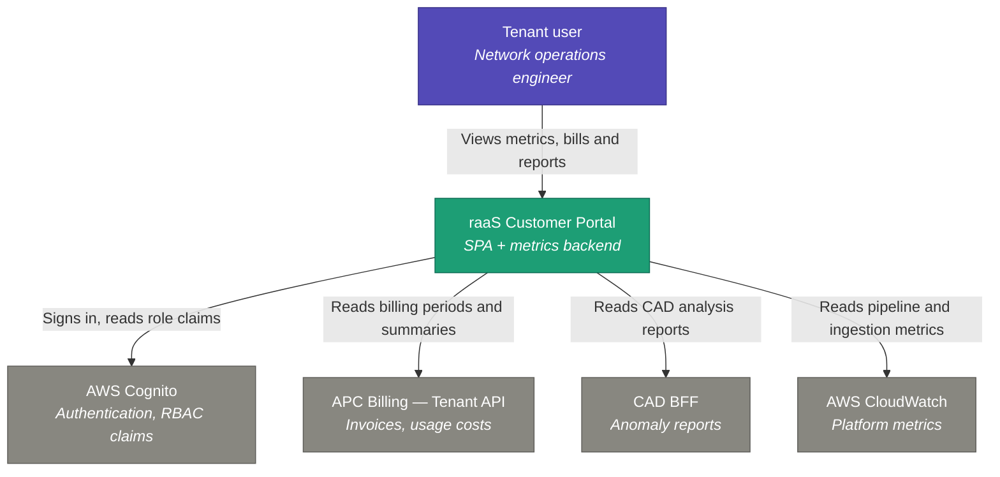
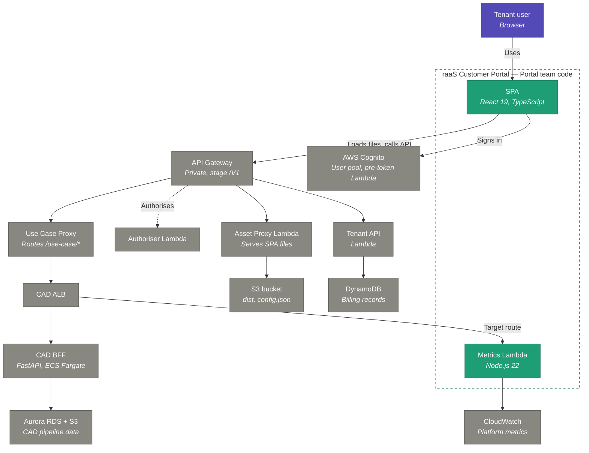
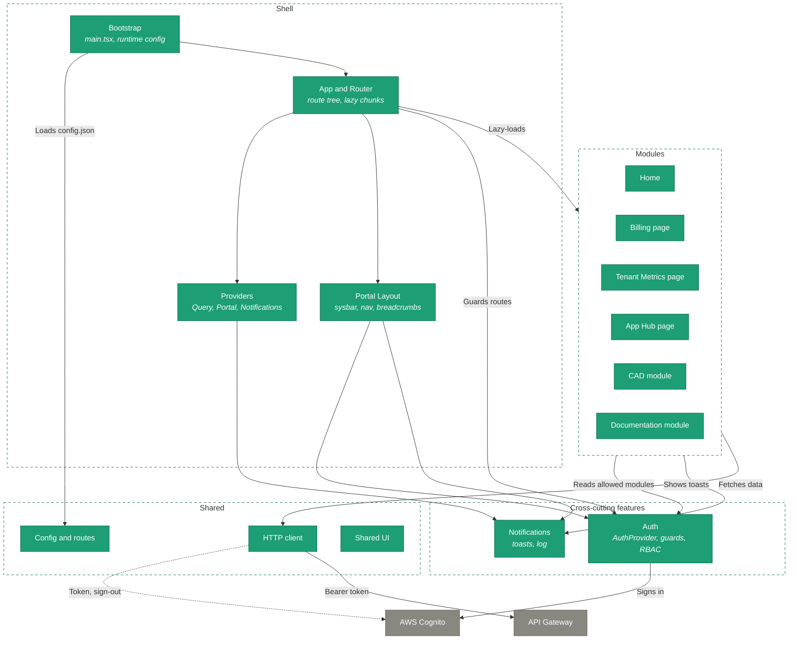

# C4 Architecture — raaS Customer Portal

Architecture of the **raaS Customer Portal** described with the [C4 model](https://c4model.com/) — Context, Containers, Components, Code — four levels of zoom from the system in its environment down to code.

- **rApp** — an application for the RAN (Radio Access Network): analytics, optimisation, diagnostics.
- **raaS** (Agentic rApp as a Service) — Ericsson's cloud platform that hosts rApps and sells them to mobile operators as a managed service, instead of shipping software the operator installs and runs itself.

This portal is the customer-facing interface of that platform.

Source repository: `eric-raas-csw-customer-portal-ra`

| Level | Scope | Status |
|---|---|---|
| Level 1 — System Context | The portal and the systems around it | ✅ Done |
| Level 2 — Containers | Deployable units and how a request travels | ✅ Done |
| Level 3 — Components | Inside the SPA container | ✅ Done |
| Level 4 — Code | State flow, key modules | ⬜ To do |

---

## Level 1 — System Context

Who uses the portal and which external systems it depends on. The portal is a single black box at this level.

> [!note] Reading the colours
> Purple — person. Green — the system in scope, owned by the Portal team. Grey — external systems owned by other teams.

### Person: Tenant user

A network operations engineer at the customer organisation. Uses the portal to see anomalies detected in their 5G RAN, pipeline health and monthly cost.

Access is role-based: two users of the same tenant may see different modules.

### Software system: raaS Customer Portal

**In scope. Owned by the Portal team.**

The customer-facing SPA for the platform. Aggregates four unrelated backends into four modules — App Hub, Tenant Metrics, Billing and Documentation — and holds almost no business logic of its own.

Deployed per tenant as static files on AWS S3, served through a private API Gateway. Cognito identifiers are injected at runtime, so one build fits any tenant.

### External system: AWS Cognito

**Owned by APC (Application Plane Core).**

Managed user pool handling sign-in via SRP (Secure Remote Password), password reset and first-login change. Issues the ID token that every API call carries.

Also the source of RBAC: a pre-token Lambda adds role claims, which the portal maps to visible modules.

### External system: APC Billing — Tenant API

**Owned by APC.**

A Lambda reading tenant usage records from DynamoDB. Returns available billing periods and a cost summary per use case, optionally broken down by day.

The portal is a pure consumer — data is scoped by the Cognito claim, not by request parameters.

> [!warning] Current status
> Blocked. The Lambda's ECR images were deleted, so Billing runs on mock data.

### External system: CAD BFF

**Owned by the CAD team.**

CAD (Cell Anomaly Detector) 5G is the first rApp in the App Hub: it runs deep-learning anomaly detection over hourly KPIs and classifies every cell into one of eight categories daily.

The BFF (Backend-for-Frontend) is a Python/FastAPI service on ECS Fargate built solely for this UI. It queries Aurora RDS and S3, and returns screen-ready reports with filtering, sorting and pagination already applied.

### External system: AWS CloudWatch

**Metrics published by the CAD and ADS (Application Data Service) teams.**

The platform's metric store. CAD publishes to the `RaaS/CAD5g` namespace; ADS publishes ingestion metrics to `ADS/EIC/PM`, `ADS/EIC/CM` and `ADS/KPI`.

External rather than internal because no team offers a metrics API — the portal reads CloudWatch through a Lambda it owns.

> [!warning] Current status
> `RaaS/CAD5g` emits in dev. The `ADS/EIC/*` namespaces are defined but not emitting yet.

### Relationships

| From | To | Purpose | Protocol |
|---|---|---|---|
| Tenant user | Portal | Views metrics, bills and reports | HTTPS, browser |
| Portal | Cognito | Sign-in, token refresh, role claims | HTTPS, Amplify SDK |
| Portal | Tenant API | Billing periods and cost summaries | HTTPS, JSON, bearer token |
| Portal | CAD BFF | Anomaly reports and object selectors | HTTPS, JSON, bearer token |
| Portal | CloudWatch | Pipeline and ingestion metrics | AWS SDK, via own Lambda |

### Ownership

| Team | Repository | Provides |
|---|---|---|
| **Portal** (us) | `eric-raas-csw-customer-portal-ra` | SPA + metrics Lambda |
| Application Plane Core | `eric-raas-csw-application-plane-core` | Cognito, authoriser, API Gateway, Tenant API, DynamoDB |
| CAD | `eric-raas-csw-cad` | CAD BFF, pipeline, `RaaS/CAD5g` metrics |
| ADS | `eric-raas-csw-ads` | Data ingestion, `ADS/EIC/*` metrics |

**The portal owns none of its dependencies.** Every external system belongs to another team, which makes the deployment prerequisites a cross-team coordination problem rather than a technical one.

---

## Level 2 — Containers

Deployable and data-holding units inside and around the portal, and how requests travel between them. A container here is anything that runs or stores data on its own — a browser app, a Lambda, a database — not a Docker container.

> [!note] Reading the colours
> Purple — person. Green — containers whose code the Portal team writes. Grey — platform and external containers owned by other teams. The dotted arrow is a side check, not part of the data path.

### Request paths

1. **Load** — the browser asks API Gateway for a page, Asset Proxy Lambda reads the file from S3 and returns it. The SPA is plain static files rendered in the browser; no container runs it.
2. **Data** — the running SPA calls API Gateway with the Cognito token. Billing goes to Tenant API; CAD reports and metrics go through Use Case Proxy and the CAD ALB.

### Containers owned by the Portal team

| Container | Technology | Responsibility | Status |
|---|---|---|---|
| SPA | React 19, TypeScript, Vite | Runs in the browser. Handles sign-in, role-based module access and rendering of all four modules. Reads Cognito identifiers from `config.json` at startup, so one build fits any tenant. | Functional in dev |
| Metrics Lambda | Node.js 22 | Reads CloudWatch and returns JSON for the Tenant Metrics module. Stateless. Source in `infrastructure/external-files/portal-metrics-lambda/`, deployed by the CAD infrastructure Terraform. | Deployed in dev |

### Platform and external containers

| Container | Technology | Responsibility | Owner | Status |
|---|---|---|---|---|
| API Gateway | AWS API Gateway, private, stage `/V1` | Single entry point for static files and API calls. VPC-only. | APC | Exists in dev (poc stage) |
| Authoriser Lambda | AWS Lambda | Authorises requests at the gateway. | APC | — |
| Asset Proxy Lambda | AWS Lambda | Reads SPA files from S3 and returns `index.html` for client-side routes. Needed because CloudFront is forbidden by cloud policy. | TBD (Portal or APC) | Code not in this repo |
| S3 bucket | AWS S3, private | Holds `dist/` and `config.json`, uploaded by Terraform on each deploy. | CAD infrastructure Terraform | — |
| AWS Cognito | User pool, app client, pre-token Lambda | Sign-in and password flows. Adds role claims (`custom:userRoles`) to the ID token. | APC | Temp dev pool works; prod pool blocked |
| Tenant API | AWS Lambda | Billing periods and cost summaries, scoped to the tenant by the token. | APC | Blocked: ECR images deleted; mock data in dev |
| DynamoDB | AWS DynamoDB | Tenant usage and billing records. | APC | Empty in APC dev |
| Use Case Proxy | Not documented | Routes `/use-case/cad5g/*` to the rApp backend. | APC | Routing under discussion |
| CAD ALB | AWS ALB | Fronts the CAD services: BFF and, on the target route, Metrics Lambda. | CAD | — |
| CAD BFF | Python, FastAPI, ECS Fargate | Screen-ready CAD reports: analysis, class summary, inference, KPIs. | CAD | Exists in dev |
| Aurora RDS + S3 | AWS | CAD pipeline output queried by the BFF. | CAD | — |
| CloudWatch | AWS CloudWatch | Metric store: `RaaS/CAD5g`, `ADS/EIC/PM`, `ADS/EIC/CM`, `ADS/KPI`. | CAD and ADS publish | CAD emits in dev; ADS not yet |

> [!warning] Open points
> - **Asset Proxy owner** — not agreed between Portal and APC.
> - **Metrics routing** — the diagram shows the target path via the CAD ALB. The current dev route goes straight from API Gateway to the Lambda (proof-of-concept), and the final routing is still being assessed.
> - **Use Case Proxy** — the AWS service type is not documented in this repo; confirm with APC.

> [!note] CAD frontend
> Not a separate container: it ships inside the SPA bundle as a lazy-loaded chunk. It becomes one only after the micro-frontend split planned post-FOA (First Office Application).

### Local development

`npm run dev` starts a Vite dev server with three plugins that stand in for platform containers: a billing mock (instead of Tenant API), a metrics proxy that invokes the Lambda directly, and a Swagger UI for the billing contract. With `VITE_USE_REAL_APIS=true` the plugins switch off and requests go through a tunnel to a real environment.

---

## Level 3 — Components

What the SPA container is made of. A component here is a cohesive group of code with one responsibility — a layer, a feature or a module — not a single React component.

> [!note] Reading the diagram
> Green — components of the SPA. Grey — external containers from Level 2. Dashed frames group components by layer. An arrow from a frame means every component inside it uses the target. The dotted arrow is a direct call to the Amplify SDK, not through Auth.

The SPA follows a layered layout (Feature-Sliced Design style): `app` → `pages` and `modules` → `widgets` and `features` → `shared`. Every page and module is a lazy chunk.

### Shell

| Component | Location | Responsibility |
|---|---|---|
| Bootstrap | `src/main.tsx`, `shared/config/runtime-config.ts` | Loads `config.json` before React mounts and imports `App` only after that. In local dev, falls back to `VITE_COGNITO_*` env vars when the file is missing. |
| App and Router | `src/app/App.tsx`, `router.tsx` | Configures Amplify, creates the browser router with the API Gateway stage prefix as basename, defines the route tree. Every page is loaded with `React.lazy`. |
| Providers | `src/core/providers` | Composes three providers: react-query (5 min stale time, 1 retry), Portal (overlay host of the EDS component library) and Notifications. |
| Portal Layout | `src/widgets/portal-layout` | Frame around every page: system bar, optional sidebar, breadcrumbs, slide-in profile and notification panels. Exposes the `#appbar-actions-right` slot that pages fill with their filters. |

### Cross-cutting features

| Component | Location | Responsibility |
|---|---|---|
| Auth | `src/features/auth` | `AuthProvider` holds `user` and `loading`, exposes `signIn` and `signOut`. `AuthGuard` and `ModuleGuard` protect routes. Maps Cognito roles to modules. Also owns the login, change, forgot and reset password pages. |
| Notifications | `src/features/notifications` | Toast queue, log of past notifications with an unread counter, bell icon and log panel. |

### Modules

| Component | Location | Responsibility |
|---|---|---|
| Home | `src/pages/home` | Module cards grouped by section. Cards of modules the user cannot open are greyed out. |
| Billing page | `src/pages/billing` | Loads billing periods, then the summary for the chosen range. Day/month granularity toggle, empty state, notification when no data exists. Billing client in `api/`. |
| Tenant Metrics page | `src/pages/tenant-metrics` | `MetricsFiltersProvider` keeps the applied date range and run id. Always queries CAD summary, pipeline, ML output, daily summary and data quality, plus the ADS summary. Chart queries for ADS PM (Performance Management), CM (Configuration Management) and KPI run only when such a metric is selected. |
| App Hub page | `src/pages/app-hub` | Catalogue of rApps, currently one card linking to CAD. |
| CAD module | `src/modules/cad` | Self-contained CAD UI: container with four report tabs, filters form, `CadFiltersProvider` (draft vs applied filters), one API client per report against the CAD BFF, shared table and object selector. Copied from the CAD UI repository. |
| Documentation module | `src/modules/documentation`, `src/pages/documentation` | Markdown loader (Vite glob, bundled at build time), layout with sidebar, table of contents and content renderer, CAD overview page. |

### Shared

| Component | Location | Responsibility |
|---|---|---|
| HTTP client | `src/shared/api/http-client.ts` | axios instance with the stage prefix as base URL. Adds the Cognito ID token to each request. On 401 or 403 signs out and hard-redirects to `/login`. |
| Config and routes | `src/shared/config`, `src/shared/routes` | API path constants, Amplify configuration, `ROUTES` and the three navigation trees. |
| Shared UI | `src/shared/ui` | Footer, `RouteErrorBoundary`, skeleton styles. |
| EDS components | `src/cross-ui-components` (git submodule) | Component library of the EDS (Ericsson Design System). Used by every page; cloned at the build step from a pinned commit. |

### Dependency rules

Checked by counting cross-layer imports:

| Layer | Imports from |
|---|---|
| `shared` | nothing |
| `features` | `shared` |
| `widgets` | `features`, `shared` |
| `pages` | `features`, `shared` |
| `modules/cad` | `shared` and itself |
| `modules/documentation` | nothing |
| `core` | `features` |

Dependencies point one way, so no layer is imported by the one below it. The HTTP client in `shared` calls the Amplify SDK directly instead of importing Auth, which keeps that rule intact.

> [!warning] Incomplete local checkout
> Several folders exist but are empty in the checkout this note was based on: `pages/billing/ui/components`, `modules/cad/ui/filters-form`, `features/auth/ui/components`, `features/auth/ui/hooks` and the `cross-ui-components` submodule. The CAD README also mentions an `ai-chat` panel that is absent. Descriptions of these parts rest on imports and READMEs, not on source.

> [!note] Config fallback
> `README.md` calls the `VITE_COGNITO_*` variables unused. `runtime-config.ts` still reads them as a fallback when `config.json` cannot be fetched.

---

## Level 4 — Code

⬜ To do.

---

## Glossary

| Term | Meaning |
|---|---|
| **raaS** | Agentic rApp as a Service — Ericsson's cloud platform hosting RAN applications for mobile operators |
| **rApp** | An application for the Radio Access Network: analytics, optimisation, diagnostics |
| **Tenant** | A customer of the platform, with an isolated data scope |
| **APC** | Application Plane Core — team and repository owning the platform's shared core |
| **CAD** | Cell Anomaly Detector 5G — the first rApp in the App Hub |
| **ADS** | Application Data Service — ingests and enriches the RAN data CAD consumes |
| **BFF** | Backend-for-Frontend — a backend tailored to one specific user interface |
| **FOA** | First Office Application — first deployment in a real customer account |

---

## Sources

- `README.md` — configuration, API URL resolution, deployment
- `doc/overview.md` — modules, tech stack, roadmap
- `doc/auth.md` — Cognito and RBAC
- `doc/billing.md` — billing API ownership and status
- `doc/app-hub.md` — CAD integration and BFF
- `doc/metrics.md` — metrics Lambda and CloudWatch namespaces
- `infra/catalyst/PREREQUISITES.md` — external dependencies, ownership, status matrix
